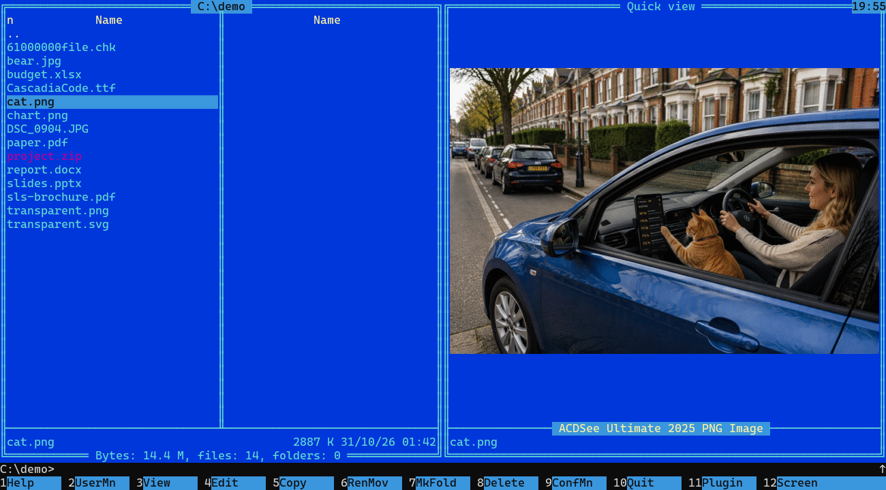
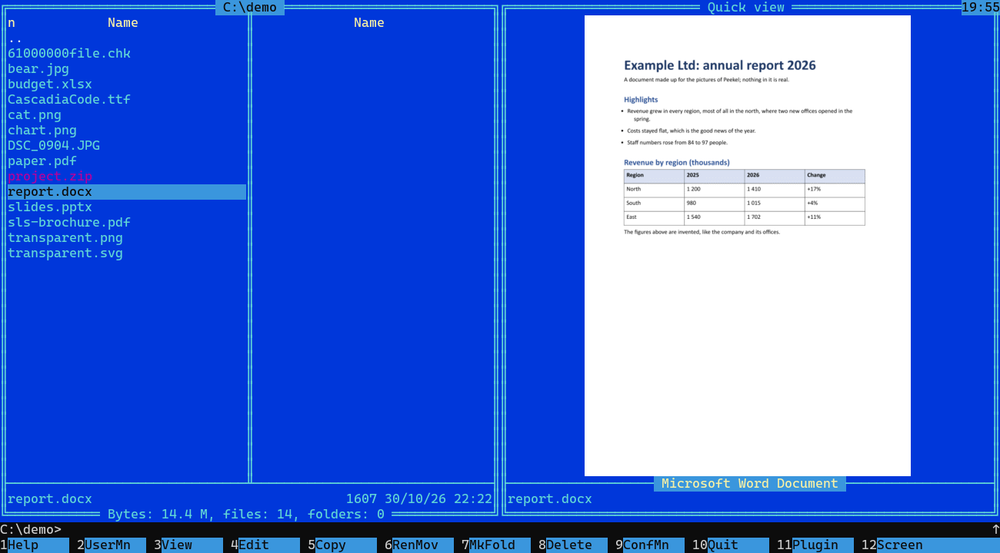
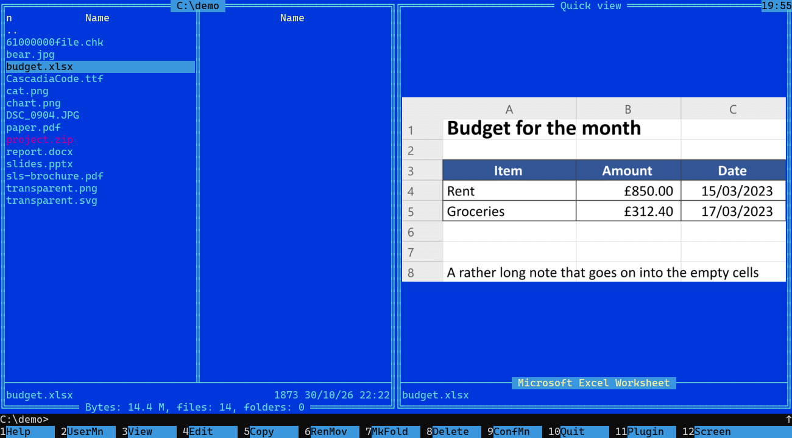
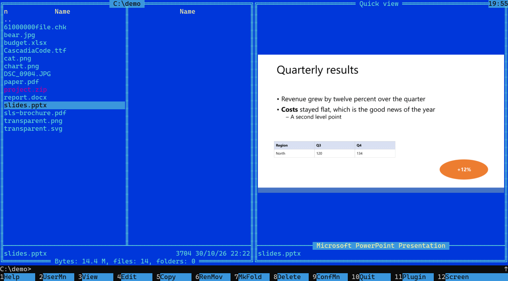
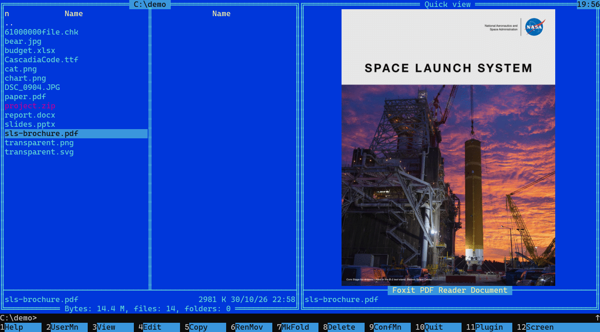
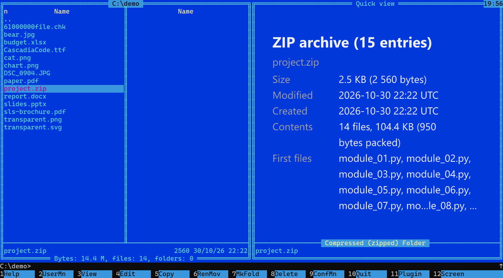
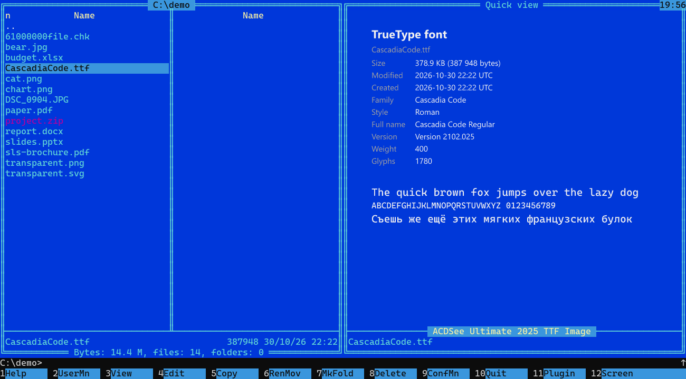
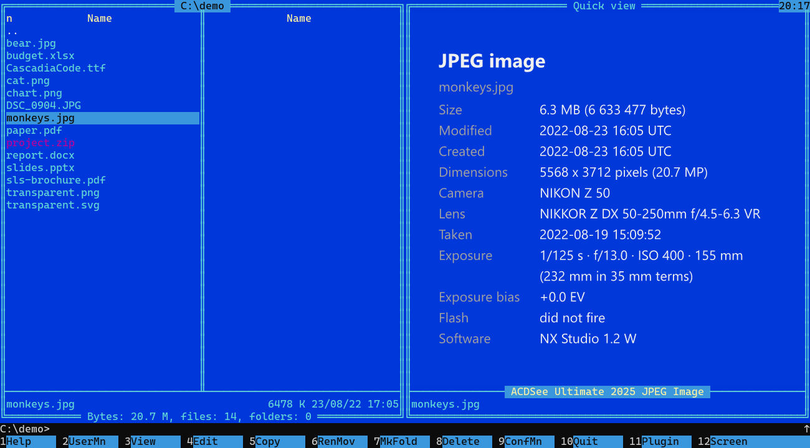
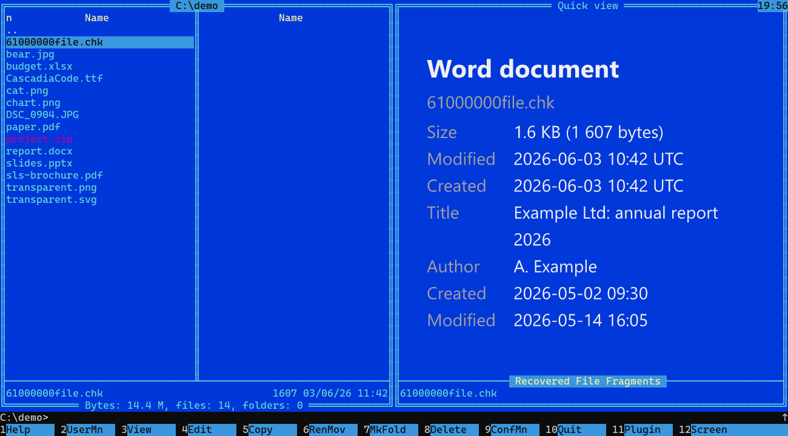

# Peekel

[Русская версия](README.ru.md)



**Peekel is a quick-view plugin for Far Manager**: press Ctrl+Q and see what a file is, in the panel: a picture, SVG, a PDF, a DjVu book, the
start of a Word, PowerPoint, Excel or OpenDocument file, and a card for fonts, programs and archives.

A sibling project, [Peekel viewer](https://github.com/loglux/peekel-viewer), is a file viewer for the terminal that also reads PDF and
DjVu books: put it on F3 in Far or in Midnight Commander, on Windows and Linux.

## Why

- **Ctrl+Q works in Windows Terminal.** Far's quick view shows the picture, the document or a card in the panel, as you move
  over the files.
- **No second window.** Peekel draws with Sixel graphics inside the terminal's own cells, so nothing floats over the console
  and has to be kept in place, and it works over SSH too.
- **More than pictures.** A PDF, a DjVu book, the start of a Word, PowerPoint, Excel or OpenDocument file, a card for a font (in its own letters), a
  program, a ZIP: the kind, size, dates, what is inside. When the name says nothing (a recovered `.chk` fragment) it tells what a
  file is by its content, and it warns when a name and the content disagree.
- **Damaged files are safe.** The size, the time and the depth of reading are limited; a broken file gives a message, not a
  crash.
- **One DLL, no runtime.** Written in Rust. Open source, MIT or Apache-2.0.

## What it looks like

Far Manager, the quick view (Ctrl+Q) with the plugin. The PDF cover is public domain ([credits](docs/images/CREDITS.md)).

**A Word document**



**An Excel sheet**



**A PowerPoint slide**



**A PDF**



**A ZIP archive: what is inside**



**A font, in its own letters**



**A photo: Ctrl+Alt+I shows the card with its EXIF**



**A file whose name says nothing, recognised by its content**



## What it shows

| What | In the quick view |
|---|---|
| PNG, JPEG, GIF (first frame), BMP, WebP, TIFF, SVG | the picture |
| RAW photographs (NEF, CR2, ARW, DNG, ORF, PEF and others) | the camera's own JPEG preview (the full size in most files), in a few tenths of a second |
| JPEG XL (the first frame) and DDS (DXT1 to BC7 and the common uncompressed kinds) | the picture; Peekel reads them itself, no codec of the system is needed |
| HEIC, AVIF, JPEG XR and whatever else **your Windows** has a codec for | the picture, only where the codec is installed (Windows' own codecs; the menu Commands, Plugin commands, "Peekel: formats" lists what yours has) |
| PDF (text pages and scans; not password-protected) | the first page |
| DjVu (scanned books) | the first page; the card gives the number of pages and the size of the page (read by a reader of our own, written from the format's open specification; not read yet: the text layer and documents whose pages are separate files) |
| Word (.docx), PowerPoint (.pptx), Excel (.xlsx) | the start, the first slide, the top of the sheet |
| OpenDocument: text (.odt), spreadsheet (.ods), presentation (.odp) | the start, the top of the sheet, the first slide |
| Fonts, programs (exe, dll), ZIP, gzip, any other binary file | a **card**: the kind, size, dates; fonts in their own letters, programs with icon, version and company, ZIP with its files |
| Files inside an archive shown by ArcLite, 7-Zip and the like | the same as for any file |

A picture with a colour profile (Display P3, Adobe RGB) is converted to sRGB, and EXIF orientation is honoured. **Documents are
previews, not copies**: words are wrapped by a guess, and charts, text boxes, headers and footers and much else are not drawn.
Text in SVGs and documents is drawn with the fonts installed on the machine; a document that names a font that is not installed
gets another one.

### Formats from Windows (WIC)

HEIC, AVIF, JPEG XR, icons and similar files are opened by the codecs of **your Windows** (the Windows Imaging Component,
WIC), not by Peekel's own code. So what opens depends on the PC: Windows has some codecs itself (JPEG XR, icons and others),
and others are extensions from the Microsoft Store (HEIF and others) that may not be installed. JPEG XL and DDS are read by Peekel itself.

- **What your PC opens:** in Far, the menu Commands, Plugin commands, "Peekel: formats" lists it. (F11 opens the same menu, but
  Windows Terminal takes F11 for full screen.)
- **When there is no codec:** the card of a HEIC or AVIF file says so and names the Microsoft Store extension that may
  add one. While that card is shown, **Ctrl+Alt+S** opens the Store on the page of that extension; whether to install it is
  yours to decide, Peekel installs nothing.
- What Peekel reads itself (PNG, JPEG, RAW by its preview and the rest of the table above) does not depend on any of this.

## Install

Take the archive of the [latest release](../../releases/latest): `Peekel-<version>-windows-x64.zip`. It has a `.sha256` file:
check it. You need Far 3.0 (64-bit) in a terminal that shows Sixel: **Windows Terminal 1.22 or newer**, or xterm, mlterm, foot and
others. **ConEmu is not supported**: it does not show Sixel (the newest release, 230724 of July 2023, draws no picture) and is no
longer developed.

Close Far and run `install.ps1` from the archive. It finds your Far; if it finds none or several, say which:
`.\install.ps1 -Far 'C:\Tools\Far'`. `-Uninstall` removes the plugin, `-WhatIf` shows what would be done. By hand: copy the folder
`Peekel` into the `Plugins` folder next to `Far.exe` (or into `%APPDATA%\Far Manager\Profile\Plugins`). Start Far, press Ctrl+Q
and move over files. Peekel may conflict with other plugins that handle quick view (Ctrl+Q).

From source: install Rust (the version is in `rust-toolchain.toml`) and run `cargo build --release -p peekel-far`; the plugin is
`target/release/peekel_far.dll`.

## Using it

Press Ctrl+Q in a panel to make the other panel a quick view, and move the cursor: a picture, a document or a card is drawn in
the frame, over the text Far would print there; text files are shown by Far as usual. **Ctrl+Alt+I** shows the card of the file (kind, size, dates, the EXIF of a photo)
instead of the picture; press it again to go back. If something is wrong, set an environment
variable before starting Far:

| Variable | Does |
|---|---|
| `PEEKEL_FAR_LOG=<file>` | the plugin writes what it does to this file (send it with a bug report) |
| `PEEKEL_OFF=hook` | switches the plugin off without removing it |
| `PEEKEL_CELL=10x20` | turns off the plugin's queries to the terminal; the size of the cell is worked out from the window |
| `PEEKEL_REAL_CELL=13x28` | the size of a cell by hand, when the plugin cannot work it out from the window |
| `PEEKEL_BG=#0037DA` | the colour of the panels as a HEX code; used when the terminal is not asked |

There is no settings dialog yet; if you want to turn something off, say which.

## Turn off "ClearType friendly redraw"

In Far: F9 › Options › Interface settings, clear "ClearType friendly redraw", then Shift+F9 to save the settings.
(In `far:config` it is `Interface.ClearType`.)

Why. With this option on, Far redraws a whole row of the screen whenever anything in the row changes. When you move the cursor in a
panel, the rows of the cursor bar are redrawn across the whole screen, the terminal erases the part of the picture that lies on them,
and stripes cross the picture until it is drawn again. With the option off, Far redraws only what changed and leaves the picture
alone; a dialog opened over the picture leaves it whole round the dialog too.

Far's source says the option is meant against thin stripes that ClearType font smoothing left in the classic Windows console. The
plugin does not work in the classic console (it needs a terminal that draws Sixel, such as Windows Terminal 1.22 or newer), and
Windows Terminal draws the text itself: with the plugin, the option does nothing useful. While it is on, the plugin shows a short
hint in the quick view and in its box (F11 › Peekel: formats).

## Working with the macro on Esc

To draw a picture the right size, the plugin asks Windows Terminal for the size of a character cell in pixels and for the colour of the panels (the picture is laid on that colour, so no strip of another colour shows round it). The terminal answers with sequences that begin with Esc. Windows Terminal always reports the same cell size, 10 x 20, whatever the font is, while the real size depends on the font and the scale of the screen (for example Consolas at 150 % is 13 x 28). So the plugin works the real size out itself, from the window of the terminal, with the data of Windows.

The macro `Panel.Esc.lua` (it hides and shows the panels on Esc) interferes with this exchange. The answers of the terminal begin with Esc, and the macro acts on Esc. To use the macro with the plugin, set the two variables of the table above before starting Far:

- `PEEKEL_CELL=10x20`: the plugin stops asking the terminal, and the size of the cell is still worked out from the window.
- `PEEKEL_BG=#0037DA`: the colour of the panels of your theme as a HEX code. Without it dark blue (`#000080`) is used, and a strip of that colour may show at the picture's edge.

Set the variables in a PowerShell window and start Far from that same window (put the path of your Far in place of `<path to Far.exe>`):

```powershell
$env:PEEKEL_CELL='10x20'; $env:PEEKEL_BG='#0037DA'; & "<path to Far.exe>"
```

If you do not know the colour of the panels, it can be taken from the plugin's log. Start Far once **without the macro** (turn it off for this one start: while the plugin asks the terminal, the macro interferes) and without `PEEKEL_CELL`, but with the variable `PEEKEL_FAR_LOG`, set in PowerShell, starting Far from that same window:

```powershell
$env:PEEKEL_FAR_LOG="$env:TEMP\peekel.log"; & "<path to Far.exe>"
```

Open a picture in the quick view, wait twenty seconds and close Far. In the file `peekel.log` the line "the terminal says its colours are [...]" lists the colours of the terminal's palette (red, green, blue); Far's blue is the fifth (number 4, counted from 0), for example `[0, 55, 218]`. Write it as a HEX code (`#0037DA`) or with commas (`0,55,218`), turn the macro on again and set `PEEKEL_BG`.

## Licence

Peekel is under **either** of the [MIT licence](LICENSE-MIT) or the [Apache License 2.0](LICENSE-APACHE), at your option.
Copyright (c) 2026 Vladislav Sorokin. The licences of the libraries inside the DLL are in `THIRD-PARTY-LICENSES.txt` in the
archive; all are permissive (MIT, Apache-2.0, BSD, Zlib, Unicode).
