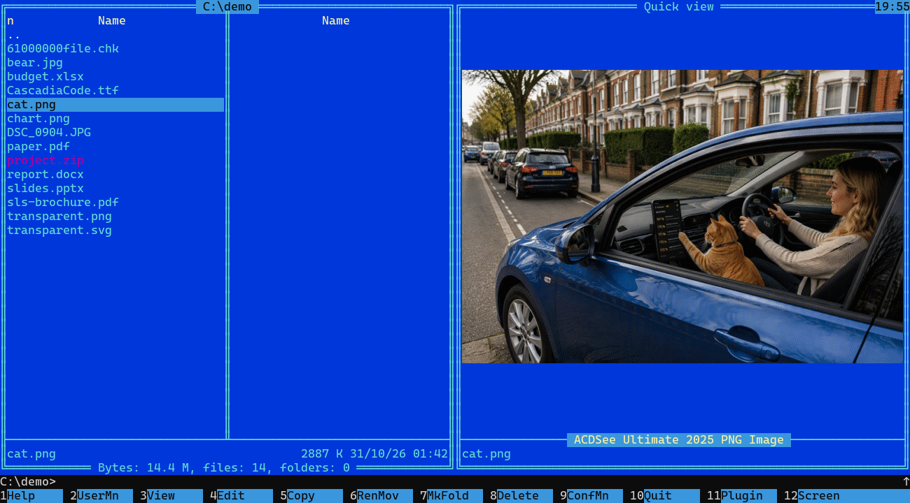
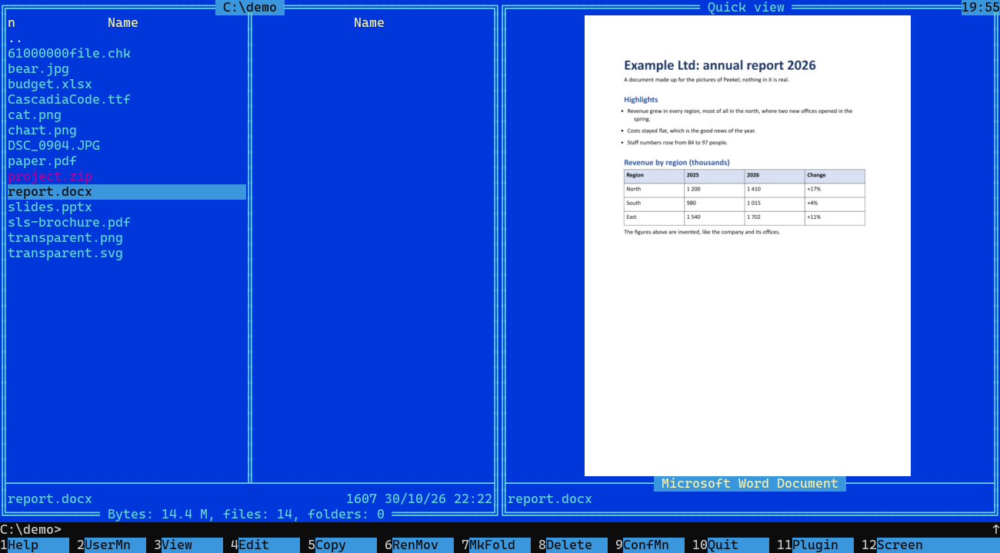
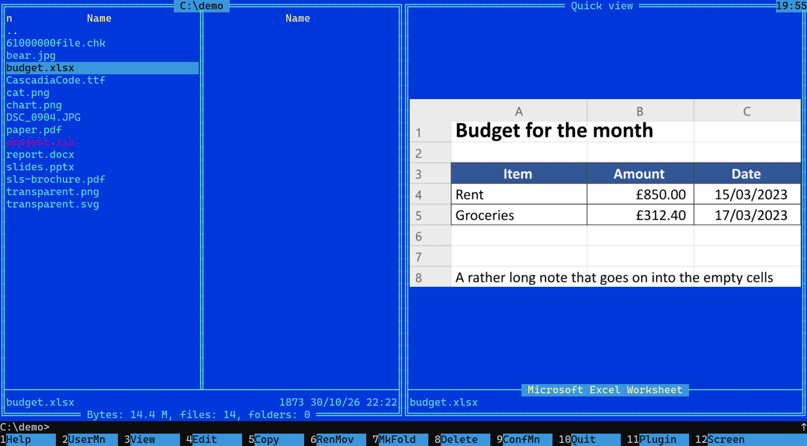
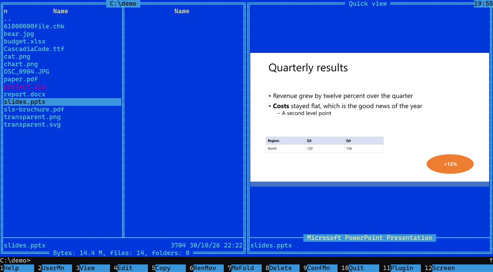
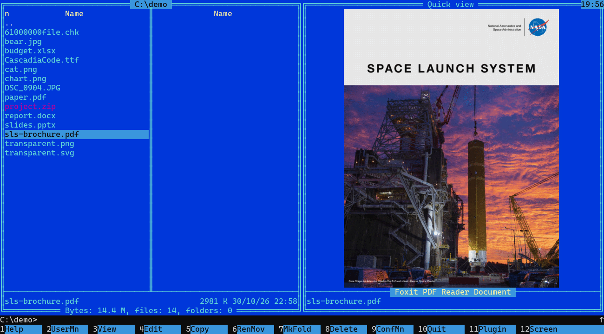
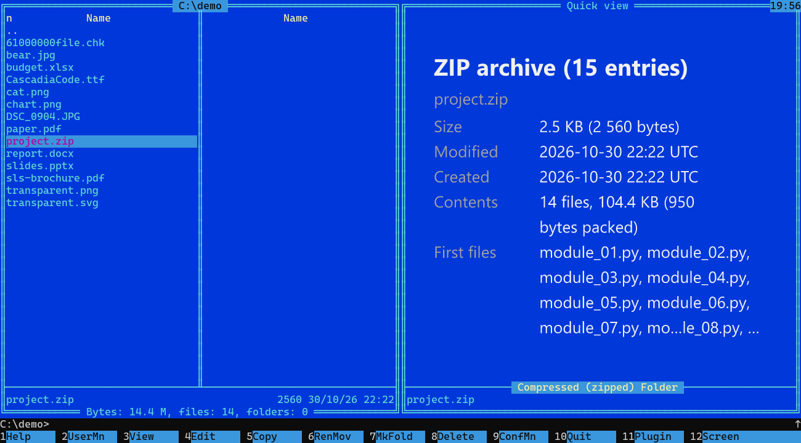
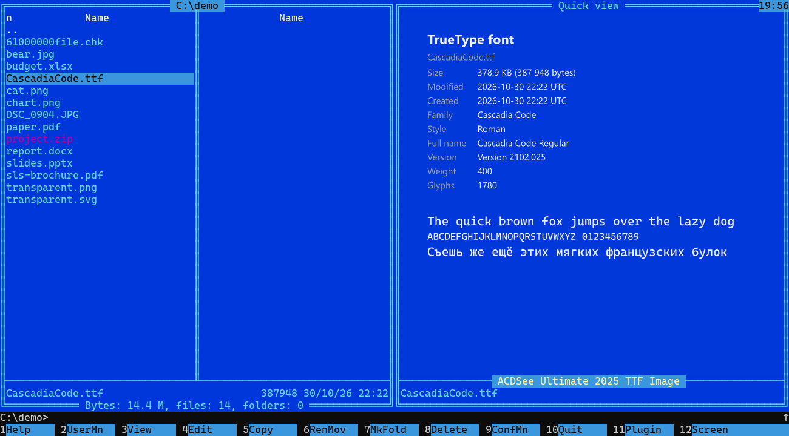
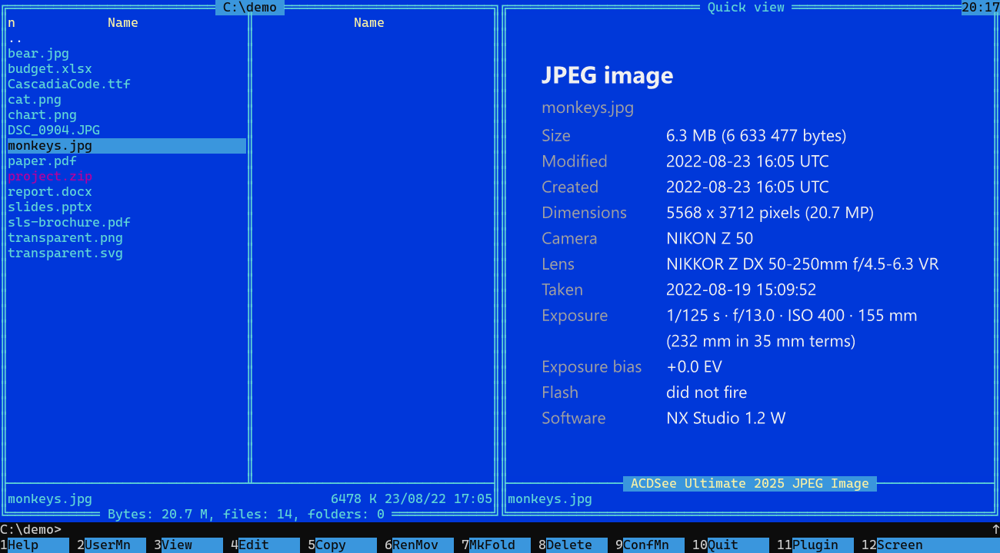
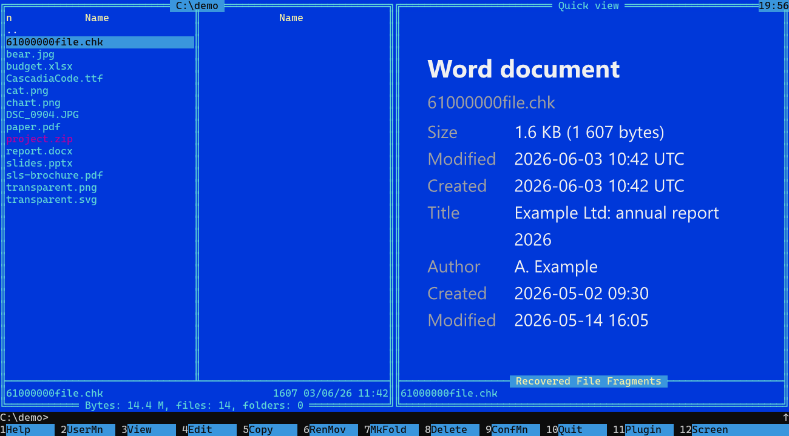

# Peekel

[English version](README.md)

**Peekel это плагин быстрого просмотра для Far Manager**: нажмите Ctrl+Q и увидите в панели, что это за файл: картинку, SVG, PDF, книгу DjVu,
начало файла Word, PowerPoint или Excel, карточку для шрифтов, программ и архивов.

Консольный просмотрщик (для F3, Linux и Midnight Commander) работает и готовится; он будет выложен чуть позже.

## Почему он

- **Ctrl+Q работает в Windows Terminal.** Быстрый просмотр Far показывает картинку, документ или карточку в панели, пока вы
  ведёте курсор по файлам.
- **Никакого второго окна.** Peekel рисует графикой Sixel в ячейках самого терминала: ничего не висит поверх консоли, и не
  нужно следить, чтобы оно не съехало; работает и по SSH.
- **Не только картинки.** PDF, книга DjVu, начало файла Word, PowerPoint или Excel, карточка для шрифта (его же буквами), программы, ZIP:
  тип, размер, даты, что внутри. Когда по имени ничего не понять (обломок `.chk` после восстановления диска), он говорит, что
  это за файл, по содержимому, и предупреждает, если имя и содержимое не совпадают.
- **Испорченные файлы не страшны.** Размер, время и глубина разбора ограничены; сломанный файл даёт сообщение, а не падение.
- **Одна DLL, без среды выполнения.** Написан на Rust. Открытый код, MIT или Apache-2.0.

## Как выглядит

Far Manager, быстрый просмотр (Ctrl+Q) с плагином. Обложка PDF в общественном достоянии ([источники](docs/images/CREDITS.md)).

**Документ Word**

**Лист Excel**

**Слайд PowerPoint**

**PDF**

**Архив ZIP: что внутри**

**Шрифт его же буквами**

**Фотография: Ctrl+Alt+I показывает карточку с EXIF**

**Файл, по имени которого ничего не понять, узнан по содержимому**

## Что показывает

| Что | В быстром просмотре |
|---|---|
| PNG, JPEG, GIF (первый кадр), BMP, WebP, TIFF, SVG | картинка |
| RAW-фотографии (NEF, CR2, ARW, DNG, ORF, PEF и другие) | собственный JPEG-превью камеры (в большинстве файлов полного размера), за доли секунды |
| JPEG XL (первый кадр) и DDS (от DXT1 до BC7 и обычные несжатые виды) | картинка; читает сам Peekel, кодек системы не нужен |
| HEIC, AVIF, JPEG XR и всё остальное, для чего в **вашей Windows** есть кодек | картинка, но только там, где кодек установлен (кодеки самой Windows; меню Commands, Plugin commands, «Peekel: formats» показывает, что есть у вас) |
| PDF (текстовые страницы и сканы; без пароля) | первая страница |
| DjVu (отсканированные книги) | первая страница; карточка даёт число страниц и размер страницы (читает собственный читатель, написанный по открытой спецификации формата; пока не читаются: текстовый слой и документы, у которых страницы лежат отдельными файлами) |
| Word (.docx), PowerPoint (.pptx), Excel (.xlsx) | начало, первый слайд, верх листа |
| Шрифты, программы (exe, dll), ZIP, gzip, любой другой бинарный файл | **карточка**: тип, размер, даты; шрифт его же буквами, программа со значком, версией и издателем, ZIP со списком файлов |
| Файлы внутри архива, который показывает ArcLite, 7-Zip и подобные | так же, как для любого файла |

Картинка с цветовым профилем (Display P3, Adobe RGB) переводится в sRGB, поворот из EXIF учитывается. **Документы показываются как
превью, а не как копия**: слова переносятся «на глаз», а диаграммы, текстовые рамки, колонтитулы и многое другое не рисуются.
Текст в SVG и документах рисуется установленными на компьютере шрифтами; если документ просит шрифт, которого нет, будет другой.

### Форматы из Windows (WIC)

HEIC, AVIF, JPEG XR, иконки и подобные файлы открывают кодеки **вашей Windows** (Windows Imaging Component, WIC), а не
собственный код Peekel. Поэтому, что откроется, зависит от компьютера: часть кодеков есть в самой Windows (JPEG XR, иконки
и другие), а остальные это расширения из Microsoft Store (HEIF и другие), которых может не быть. JPEG XL и DDS читает сам Peekel.

- **Что открывает ваш компьютер:** в Far меню Commands, Plugin commands, «Peekel: formats» показывает список. (F11 открывает то
  же меню, но Windows Terminal забирает F11 под полный экран.)
- **Когда кодека нет:** карточка файла HEIC или AVIF говорит об этом и называет расширение Microsoft Store, которое может
  его добавить. Пока показана такая карточка, **Ctrl+Alt+S** открывает Store на странице этого расширения; ставить его или нет,
  решаете вы, Peekel ничего не устанавливает.
- То, что Peekel читает сам (PNG, JPEG, RAW по превью и остальное из таблицы выше), от этого не зависит.

## Установка

Возьмите архив из [последнего выпуска](../../releases/latest): `Peekel-<версия>-windows-x64.zip`. К нему приложен файл `.sha256`:
сверьте его. Нужен Far 3.0 (64-разрядный) в терминале с Sixel: **Windows Terminal 1.22 или новее**, либо xterm, mlterm, foot и
другие. **ConEmu не поддерживается**: он не показывает Sixel (самая новая версия, 230724 от июля 2023, не рисует картинку) и больше
не развивается.

Закройте Far и запустите `install.ps1` из архива. Он сам находит Far; если не нашёл или нашёл несколько, укажите:
`.\install.ps1 -Far 'C:\Tools\Far'`. `-Uninstall` удаляет плагин, `-WhatIf` показывает, что будет сделано. Вручную: скопируйте папку
`Peekel` в папку `Plugins` рядом с `Far.exe` (или в `%APPDATA%\Far Manager\Profile\Plugins`). Запустите Far, нажмите Ctrl+Q и ведите
курсор по файлам. Peekel может конфликтовать с другими плагинами, которые обрабатывают быстрый просмотр (Ctrl+Q).

Из исходников: установите Rust (версия в `rust-toolchain.toml`) и выполните `cargo build --release -p peekel-far`; плагин:
`target/release/peekel_far.dll`.

## Как пользоваться

Нажмите Ctrl+Q в панели, чтобы другая панель стала быстрым просмотром, и ведите курсор: картинка, документ или карточка рисуются в
рамке поверх текста, который Far напечатал бы там; текстовые файлы Far показывает как обычно. **Ctrl+Alt+I** показывает карточку файла (вид, размер, даты, EXIF фотографии)
вместо картинки; повторное нажатие возвращает картинку. Если что-то не так, задайте
переменную окружения перед запуском Far:

| Переменная | Что делает |
|---|---|
| `PEEKEL_FAR_LOG=<файл>` | плагин пишет в этот файл, что делает (приложите к сообщению об ошибке) |
| `PEEKEL_OFF=hook` | выключает плагин, не удаляя его |
| `PEEKEL_CELL=10x20` | размер ячейки, который плагин берёт, не спрашивая терминал; заодно плагин перестаёт задавать терминалу любые вопросы (пользователям, у которых мешал макрос Far на Esc, это помогло), поэтому и цвет панелей не спрашивается: задайте его через `PEEKEL_BG` |
| `PEEKEL_REAL_CELL=13x28` | реальный размер ячейки вручную, если плагин не может вычислить его по окну (разделённая панель); в Windows Terminal он вычисляет сам, в том числе и при `PEEKEL_CELL` |
| `PEEKEL_BG=#0037DA` | цвет, на который кладутся картинки (фон панелей), вручную; цвет панелей, как вы его видите (для первой пробы подойдёт «Blue» вашей цветовой схемы в настройках Windows Terminal: `#0037DA` в схеме Campbell); цвет, не совпадающий с цветом панелей, виден полосой справа и снизу у картинки |

Окна настроек
пока нет; если захотите что-то отключить, скажите что.

## Вопросы

**Зачем плагин задаёт вопросы терминалу?** Чтобы нарисовать картинку правильного размера, ему нужны две вещи, которые знает только терминал:
сколько пикселей в ячейке знакоместа и какого цвета панели (картинка кладётся на этот цвет, чтобы вокруг неё не было полосы другого цвета).
Он спрашивает Windows Terminal escape-последовательностями (что ты такое, размер ячейки, 16 цветов), а терминал отвечает, «набирая» escape-последовательности
во вводе; плагин вынимает их раньше, чем их увидит Far. Спрашивает при старте, при смене окна или шрифта и раз в 15 секунд, пока вы
ничего не печатаете.

**Windows Terminal говорит, что ячейка 10 x 20. Это неправда?** Он говорит так всегда, при любом шрифте (так считает консольный хост за
терминалом). Настоящая ячейка зависит от шрифта и масштаба экрана: на компьютере автора Consolas при 150 % даёт 13 x 28 пикселей, Cascadia
Code 14 x 28. Терминал растягивает картинку по настоящим ячейкам, поэтому у шрифта, ячейка которого не 1 : 2, картинка, сделанная под 10 x 20,
выходит слишком высокой (на 8 % с Consolas). Поэтому плагин вычисляет настоящую ячейку по тому, что Windows говорит об окне терминала: размер
его рабочей области, масштаб экрана, высота заголовка и сколько в нём столбцов и строк текста. Он ищет целые размеры ячейки, которые подходят
(с учётом полей и полосы прокрутки), берёт ответ, только если он единственный и форма правдоподобна (от 1 : 1,4 до 1 : 3), а в другом терминале, в
разделённой панели или когда не уверен, ничего не берёт и рисует как без этого. Это не простое деление ширины на число столбцов.

**Макрос Far на Esc мешает плагину.** Макрос, который что-то делает на каждый Esc при пустой командной строке (например, прячет и показывает
панели по Ctrl+O), конфликтует с плагином: об этом сообщили двое, и автор это видел сам. **Причина это догадка, не доказана:** каждый ответ
терминала начинается с Escape, и макрос может принять его за нажатие. Обход: `PEEKEL_CELL=10x20`, заданная до запуска Far (один
пользователь задал её в `_macroinit.lua`): плагин тогда ничего не спрашивает у терминала. Начиная с 0.5.0 он всё равно вычисляет настоящую ячейку по окну,
так что картинки сохраняют пропорции при любом шрифте; не может он узнать только цвет панелей: берёт синий консоли по умолчанию
(`#000080`), и если ваш терминал показывает синий Far иначе, вокруг картинки может быть видна полоса другого синего. Задайте цвет через
`PEEKEL_BG`.

**Где взять цвет для `PEEKEL_BG`?** Спросите терминал один раз: запустите Far как обычно (без `PEEKEL_CELL`, а макрос на этот один запуск
выключите) с заданной `PEEKEL_FAR_LOG=<файл>`, откройте картинку, подождите секунд двадцать и закройте Far. В логе строка «the terminal says its
colours are [...]» перечисляет цвета палитры терминала как красный, зелёный, синий; синий Far это пятый по счёту (номер 4, считая с нуля). На
компьютере автора в одном запуске терминал назвал `[0, 0, 128]`, и панели были `#000080`, а в других запусках панели были `#0037DA`
(`[0, 55, 218]`, «Blue» схемы Campbell): цвет может меняться, так что если справа и снизу у картинки видна полоса другого цвета, посмотрите
ещё раз. Записывать можно `#0037DA`, `0037DA` или `0,55,218`. Если вы меняли цвета панелей в Far, то это цвет, который вы им задали.

## Лицензия

Peekel распространяется по **любой одной** из лицензий на выбор: [MIT](LICENSE-MIT) или [Apache License 2.0](LICENSE-APACHE).
Copyright (c) 2026 Vladislav Sorokin. Лицензии библиотек, вошедших в DLL, лежат в `THIRD-PARTY-LICENSES.txt` в архиве; все они
разрешительные (MIT, Apache-2.0, BSD, Zlib, Unicode).
